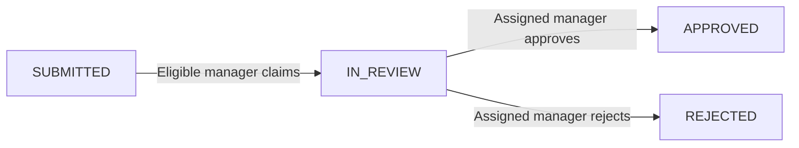

# Operations Hub

**Vue 3 + Node.js + PostgreSQL | Public engineering portfolio project**

> **Project status: design baseline accepted (OH-001).** Application code, database migrations, test suites, CI runs and a public demo are **not implemented yet**. This repository is intentionally documentation-first. No product claims below imply running functionality.

## Why this project?

Operations Hub models an internal request and approval workflow for one fictional organization. Employees submit requests, managers in the same department claim and decide them, and actions are recorded in an auditable history. It is designed to demonstrate **full-stack engineering discipline** rather than a long feature list.

The demo will use only fictional users (`example.test`), departments and records. It does not include code, endpoints or customer data from commercial or personal private projects.

## Planned stack

| Area | Technology | Engineering focus |
|---|---|---|
| Web | Vue 3, Composition API, TypeScript, Vite | Accessible UI, state and HTTP integration |
| API | Node.js LTS, Express, TypeScript, Zod | REST, validation, error handling, modular boundaries |
| Database | PostgreSQL, `pg`, versioned SQL migrations | Parameterized SQL, indexing, transactions, concurrency |
| Auth | Opaque server-side sessions, Argon2id, HttpOnly cookies | Secure session lifecycle and role/department policies |
| Tests | Vitest, Supertest, PostgreSQL integration, Playwright | Unit, integration and user journeys |
| Delivery | Docker Compose, GitHub Actions, short-lived PRs | Reproducibility, CI and documented trade-offs |

## Workflow

Managers cannot claim or approve their own submissions; managers are limited to their department. Concurrent claims must not both succeed. A request change and its audit event must commit or roll back together.

## Documentation

- [Product brief](docs/product-brief.md) — audience, purpose, scope, success criteria
- [Requirements](docs/requirements.md) — functional/nonfunctional requirements and acceptance criteria
- [Use cases](docs/use-cases.md) — positive, negative and concurrent behavior
- [Architecture](docs/architecture.md) — modular monolith, boundaries and trade-offs
- [Data model](docs/data-model.md) — proposed relational model, constraints and indexes
- [API outline](docs/api-contract-outline.md) — proposed endpoint inventory and errors
- [Decision log](docs/decisions.md) — approved product choices and deferred implementation details
- [Architecture Decision Records](docs/adr/) — ADR-0001 through ADR-0005
- [Quality and delivery](docs/quality-and-delivery.md) — pragmatic TDD, checks and review
- [Ordered backlog](docs/backlog.md) — OH-001 through OH-017

## Implementation roadmap

1. **OH-001 (this delivery):** publish accepted design baseline and reviewable documentation.
2. **OH-002:** scaffold `apps/web` and `apps/api` with strict TypeScript and a reproducible local development workflow.
3. **OH-003 / OH-004:** implement CI gates and PostgreSQL migrations in Docker.
4. **OH-005 to OH-012:** build authentication, permission rules and complete request/decision slices using automated tests.
5. **OH-013 to OH-017:** add filters, admin capabilities, hardening, OpenAPI and release readiness.

Issues and PRs are intended to demonstrate authentic engineering work; we will not fabricate activity or claim tests ran before they did.

## Running the application

Not available yet. Environment setup, reproducible commands and a tested developer guide are deliverables of OH-002 to OH-004. A public deployment is deferred pending an explicit security and cost review.

## Maintainer

[Vinicius R. Martins](https://github.com/martinsrvinicius) | [LinkedIn](https://www.linkedin.com/in/martinsrvinicius/)
