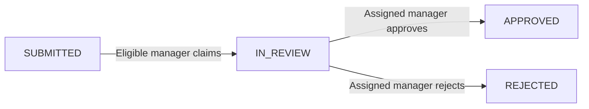

# Operations Hub

**Request and approval workflow | Vue 3 + Node.js + PostgreSQL**

> **Status: foundation implementation in review (OH-002).** The API health endpoint, a minimal Vue interface and initial tests are proposed in this branch. Authentication, workflows, database migrations and a hosted demo are not yet implemented. The foundation has not been released.

## Why this project?

Operations Hub models an internal request and approval workflow for one fictional organization. Employees submit requests, managers in the same department claim and decide them, and actions are recorded in an auditable history. The scope prioritizes predictable business rules, explicit authorization and reliable state transitions.

The development environment will use synthetic users (`example.test`), departments and request records.

## Technology stack (implemented components and planned capabilities)

| Area | Technology | Engineering focus |
|---|---|---|
| Web | Vue 3, Composition API, TypeScript, Vite | Accessible UI, state and HTTP integration |
| API | Node.js LTS, Express, TypeScript, Zod | REST, validation, error handling, modular boundaries |
| Database | PostgreSQL, `pg`, versioned SQL migrations | Parameterized SQL, indexing, transactions, concurrency |
| Auth | Opaque server-side sessions, Argon2id, HttpOnly cookies | Secure session lifecycle and role/department policies |
| Tests | Vitest, Supertest, PostgreSQL integration, Playwright | Unit, integration and user journeys |
| Delivery | Docker Compose, GitHub Actions, short-lived PRs | Reproducibility, CI and documented trade-offs |

## Workflow

Managers cannot claim or approve their own submissions; managers are limited to their department. Concurrent claims must not both succeed. A request change and its audit event must commit or roll back together.

## Documentation

- [Product brief](docs/product-brief.md) — audience, purpose, scope, success criteria
- [Requirements](docs/requirements.md) — functional/nonfunctional requirements and acceptance criteria
- [Use cases](docs/use-cases.md) — positive, negative and concurrent behavior
- [Architecture](docs/architecture.md) — modular monolith, boundaries and trade-offs
- [Data model](docs/data-model.md) — proposed relational model, constraints and indexes
- [API outline](docs/api-contract-outline.md) — proposed endpoint inventory and errors
- [Decision log](docs/decisions.md) — approved product choices and deferred implementation details
- [Architecture Decision Records](docs/adr/) — ADR-0001 through ADR-0005
- [Quality and delivery](docs/quality-and-delivery.md) — pragmatic TDD, checks and review
- [Ordered backlog](docs/backlog.md) — OH-001 through OH-017

## Implementation roadmap

1. **OH-001 (complete):** publish accepted design baseline and reviewable documentation.
2. **OH-002 (in review):** scaffold `apps/web` and `apps/api` with strict TypeScript, health checks and a local development workflow.
3. **OH-003 / OH-004:** harden CI, add Docker Compose and PostgreSQL migrations.
4. **OH-005 to OH-012:** build authentication, permission rules and complete request/decision slices using automated tests.
5. **OH-013 to OH-017:** add filters, admin capabilities, hardening, OpenAPI and release readiness.

Each deliverable is scoped to a single change, documented and reviewed before integration.

## Running the application

Development requirements and commands are described in [Local development](docs/local-development.md). Use Node.js 24, run `npm install`, then `npm run dev` to start the API and Vue application. Run `npm run check` for typechecks, tests and builds. Dependency versions and checks are pending review and must be validated in CI before this milestone is merged. Deployment is deferred pending a security and cost review.

## Maintainer

[Vinicius R. Martins](https://github.com/martinsrvinicius) | [LinkedIn](https://www.linkedin.com/in/martinsrvinicius/)
