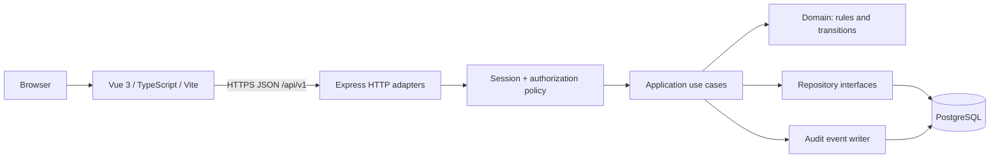

# Architecture Baseline

**Status:** Accepted architecture baseline; issue-level implementation details are tracked in `docs/decisions.md`.

## Context

The project demonstrates practical full-stack engineering, not unnecessary distributed infrastructure. Vue is a separate deployable web app; the backend is one Node.js process divided into explicit modules; PostgreSQL is the persistence store.



**Note:** The browser talks to the API; the diagram shows adapters and application boundaries rather than requiring a separate external policy service. Authentication and access checks are enforced by the API, never solely by Vue route guards.

## Candidate repository layout

```text
operations-hub/
  apps/
    web/                      # Vue 3 + Vite + TypeScript
      src/{app,features,shared}/
    api/                      # Express + TypeScript
      src/
        modules/{identity,requests,admin}/
        shared/{http,db,logging}/
        main/
      tests/{unit,integration}/
  packages/
    contracts/                # Shared DTO/contracts, not domain models
  infra/
    docker/
  docs/
    adr/
    api/
  .github/workflows/
  README.md
```

## Backend module conventions

Each business module owns its `domain/` (pure policy/types), `application/` (use cases + ports), `infrastructure/` (SQL repository/adapters), and `http/` (routes/DTO validation) boundaries. Dependencies run inward; **the domain cannot import Express, PostgreSQL or Vue code**. Keep interfaces useful, not ceremonial. Do not build a generic repository abstraction for every table.

**Identity** owns login, session verification, roles and user profile. **Requests** owns creation, visibility policy, claim, decisions and audit. **Admin** handles user management later, reusing Identity primitives without bypassing authorization.

## Transaction boundaries

Claims, approval/rejection and their audit event(s) execute in a single database transaction. A concurrent claim uses row-level locking or conditional update, with the losing request returning HTTP 409. Unit tests cover transitions; integration tests verify concurrency and actual rollback against PostgreSQL.

## Web boundaries

`features/auth`, `features/requests`, `features/admin` expose route components, focused composables and API client functions. Vue Router protects navigation for UX, but back-end policy remains authoritative. Pinia is limited to truly shared UI/session state; do not duplicate server truth in a global store without need.

## Stack candidates

- **Web:** Vue 3, TypeScript, Vite, Vue Router; Pinia only where useful.
- **API:** Node.js 24 LTS, Express, TypeScript strict mode, Zod at HTTP boundaries.
- **Data:** PostgreSQL, `pg` parameterized SQL and explicit versioned migrations (ADR-0003 accepted).
- **Quality:** Vitest for pure rules; Supertest against Express; PostgreSQL integration tests; Playwright for a few critical end-to-end flows.
- **Ops:** Docker Compose locally, GitHub Actions CI, structured application logs, environment-driven configuration.

## Design trade-offs

- **Modular monolith vs microservices:** one deployable API avoids networks, distributed transactions and fake scale requirements. A separate public Queue Manager project can demonstrate RabbitMQ/distributed concepts.
- **REST vs GraphQL:** REST is straightforward, indexable in OpenAPI and appropriate for small stable resources.
- **One organization vs multi-tenancy:** avoids adding security surfaces unrelated to the MVP; department scoping still creates meaningful authorization challenges.
- **Server sessions vs self-contained JWT:** database-backed sessions simplify revocation and are appropriate for a browser-first product. See accepted ADR-0002.
- **Direct SQL vs ORM:** explicit SQL highlights SQL skills and keeps transaction semantics visible; requires discipline around types. See accepted ADR-0003.

## Deployment (deferred)

No target hosting provider is selected. A public demo, domain, TLS termination, database hosting, budgets and protection against unauthenticated abuse will be evaluated only after the MVP and **before** an explicitly authorized deployment.
