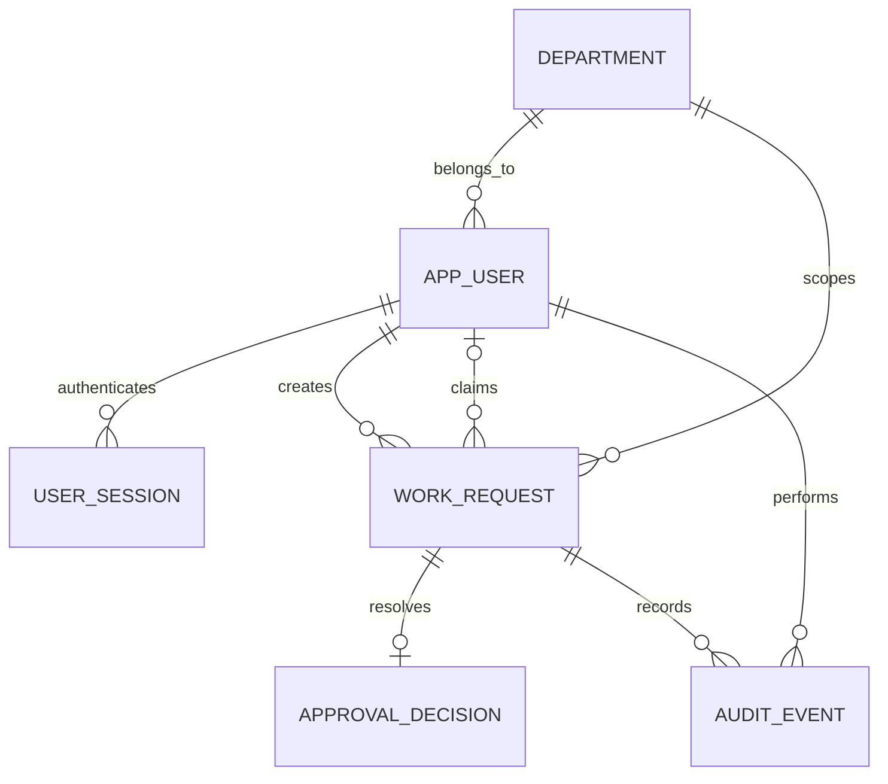

# Data Model — Candidate Schema

**Status:** Accepted design baseline, not migrated. PostgreSQL as system of record. Illustrative fields are intentionally not executable SQL migrations.

| Table | Essential columns | Notes |
|---|---|---|
| `departments` | `id uuid PK`, `name text UNIQUE`, `created_at` | One fictional organization, several departments |
| `users` | `id uuid PK`, `email citext UNIQUE`, `password_hash`, `role`, `department_id FK`, `is_active`, timestamps | `role ∈ {REQUESTER, MANAGER, ADMIN}`; no real contacts |
| `sessions` | `token_hash text PK`, `user_id FK`, `expires_at`, `created_at`, `last_seen_at` | Proposed server-side session; never persist raw cookie token |
| `requests` | `id uuid PK`, `department_id FK`, `created_by FK`, `assigned_to FK nullable`, `title`, `description`, `status`, `version int`, `created_at`, `updated_at` | `status ∈ {SUBMITTED, IN_REVIEW, APPROVED, REJECTED}` |
| `approval_decisions` | `id uuid PK`, `request_id FK UNIQUE`, `actor_user_id FK`, `outcome`, `reason nullable`, `created_at` | At most one terminal decision in MVP |
| `audit_events` | `id uuid PK`, `request_id FK`, `actor_user_id FK`, `event_type`, `from_status nullable`, `to_status`, `metadata jsonb`, `created_at` | Append-only via business API; no secrets |

## Proposed constraints

- Foreign keys for author, assignee, department and decision actor.
- A rejected `approval_decisions` row has a trimmed nonempty `reason` (SQL CHECK).
- `requests.version >= 0`; use optimistic version increments or row-locking on transitions.
- `requests.assigned_to` is non-null in `IN_REVIEW`, `APPROVED`, and `REJECTED`; null in `SUBMITTED`.
- `requests.title` is 1–120 characters after trim; description is 1–4,000 characters after trim; validate at HTTP and domain levels.
- Keep `department_id` captured at creation; moving the author's department later must **not** silently move historical requests.
- SQL cannot alone enforce cross-table requirements such as “assignee role is Manager in the request's department”; enforce in use case + transaction and test comprehensively.

## Candidate indexes

- `(department_id, status, created_at DESC, id DESC)` on requests for manager queues.
- `(created_by, created_at DESC, id DESC)` on requests for requester lists.
- `(request_id, created_at ASC, id ASC)` on audit events for history.
- `(user_id, expires_at)` on sessions for cleanup/revocation.
- Unique case-insensitive `users.email` via `citext` or a documented normalized-email strategy.

## Access query contract

Requester query always constrains `requests.created_by = actor.id`. Manager query always constrains `requests.department_id = actor.department_id`; Admin may query all only after explicit role check. Detail lookups apply the same filtering within SQL (or an equally secure centralized policy). Do not load arbitrary data and rely on the frontend to hide it.

## Assignment choice

`assigned_to` is a foreign key on `requests`, not an extra RequestAssignment table in MVP. Assignment changes are captured as immutable audit events. If future requirements need assignment intervals or SLA reporting, introduce an assignment-history table in a migration, justified by an ADR.

## Test dataset

Use examples like `manager.finance@example.test`, `requester.finance@example.test` and `manager.operations@example.test` only. Document seeded passwords as **development-only**; never enable demo credentials in real production.
